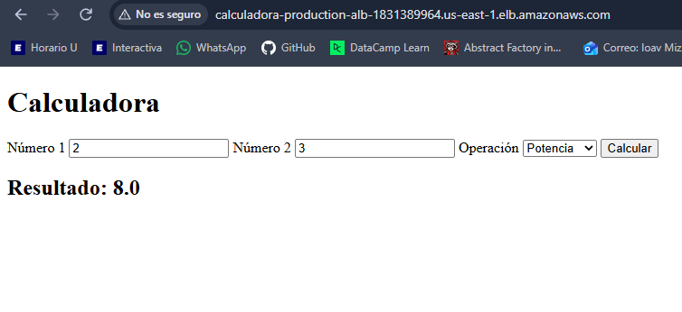
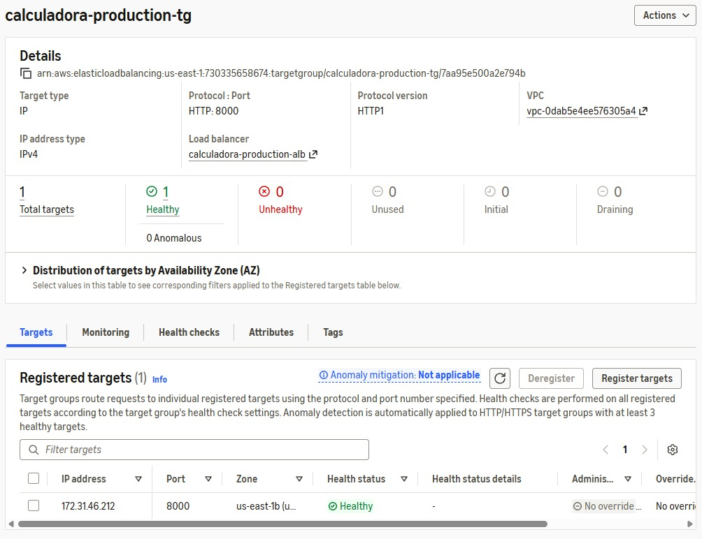

# Entregable-3-CD

## 1. Integrantes

Ioav Mizrachi - [@Imizrachim](https://github.com/Imizrachim) 

Mateo Muñoz - [@mateomunozb](https://github.com/usuario2_github)(propietario del repositorio)

## 2. Evidencias

- *URL del pipeline:* https://github.com/mateomunozb/cicd-pipeline-python-cd/actions/runs/43769175636
- *URL del Pull Request:* https://github.com/mateomunozb/cicd-pipeline-python-cd/pull/1
- *URL del ALB de Staging y URL del ALB de Producción:*

ALB de Staging: http://calculadora-staging-alb-482722611.us-east-1.elb.amazonaws.com

ALB de Producción: http://calculadora-production-alb-1831389964.us-east-1.elb.amazonaws.com
- *Capturas:* 

## 3. Preguntas

### 1. Flujo completo del pipeline

El proceso comienza cuando se realiza un commit en la rama `main`, lo que activa automáticamente el workflow de GitHub Actions. A partir de ese momento, se ejecutan los siguientes jobs:

- **`build-and-test`.** Obtiene el código, instala las dependencias y ejecuta las validaciones de calidad, las pruebas unitarias y de componente, y las pruebas de aceptación con Selenium. Después construye la imagen Docker, realiza el análisis de SonarCloud y publica la imagen en Docker Hub con el SHA del commit como identificador.

- **`deploy-staging`.** Utiliza Terraform para desplegar en AWS la imagen Docker publicada en el job anterior, creando o actualizando los recursos del entorno de Staging.

- **`test-staging`.** Espera a que la aplicación esté disponible y verifica que el endpoint `/health` devuelva el SHA esperado. Después ejecuta las pruebas de aceptación con Selenium sobre la aplicación desplegada en Staging.

- **Aprobación manual.** Una vez superadas las pruebas, uno de los revisores autorizados debe aprobar el despliegue a Producción. Antes de hacerlo, se puede ingresar a Staging y comprobar el funcionamiento de las nuevas funcionalidades.

- **`deploy-production`.** Después de la aprobación, Terraform despliega en Producción la misma imagen Docker utilizada en Staging, manteniendo el mismo SHA del commit.

- **`smoke-test-production`.** Finalmente, verifica que la página principal responda correctamente y que el endpoint `/health` devuelva el estado `ok` y la versión esperada.

De esta manera, la misma imagen Docker pasa por todo el proceso, desde su construcción y validación hasta su despliegue en ambos entornos. Las pruebas unitarias y de componente validan el código, las de aceptación comprueban el funcionamiento de la aplicación y las pruebas de humo verifican que los servicios principales estén disponibles en Producción.

### 2. Ventajas y desventajas de Terraform

Utilizar Terraform permite definir y administrar la infraestructura mediante archivos de configuración, en lugar de crear cada recurso manualmente desde la consola de AWS.

**Ventajas:** Permite automatizar la creación de recursos, mantener una configuración consistente y reutilizar los mismos archivos para diferentes entornos. Además, facilita revisar los cambios antes de aplicarlos mediante terraform plan. En nuestro caso, permitió administrar Staging y Producción utilizando workspaces independientes.

**Desventajas:** Requiere aprender su sintaxis y comprender cómo se relacionan los recursos. También es necesario administrar correctamente el estado y las variables para evitar cambios no deseados en la infraestructura.

El estado de Terraform se almacena en un bucket S3 para que esté disponible desde diferentes computadores y pueda ser utilizado por GitHub Actions. Esto evita depender del equipo de una sola persona y permite que todos trabajen sobre la misma información. Además, configuramos use_lockfile=true para evitar modificaciones simultáneas del estado.

### 3. Ventajas y desventajas de utilizar Staging

Incluir un entorno de Staging permite probar los cambios en AWS antes de desplegarlos en Producción.

**Ventajas:** Permite detectar errores relacionados con la infraestructura y la configuración, además de comprobar que la aplicación funcione correctamente en un entorno similar al de Producción. También evita que los cambios lleguen directamente al entorno final sin haber sido validados.

**Desventajas:** Mantener dos entornos implica utilizar más recursos de AWS y asumir costos adicionales. También aumenta el tiempo del pipeline, porque es necesario esperar el despliegue y las pruebas de Staging antes de continuar.

En este caso, Staging permite tener un proceso más seguro, aunque tome más tiempo. Esto ayuda a reducir el riesgo de afectar la aplicación en Producción, ya que los cambios deben superar las validaciones antes de continuar.

### 4. Diferencia entre las pruebas de Staging y Producción

Aunque ambos entornos cuentan con pruebas automatizadas, estas tienen objetivos diferentes.

**test-staging:** Ejecuta pruebas de aceptación con Selenium para comprobar que las funcionalidades de la aplicación respondan correctamente. También verifica que el endpoint /health devuelva el SHA esperado.

**smoke-test-production:** Ejecuta pruebas más básicas para comprobar que la página principal responda con HTTP 200 y que el endpoint /health devuelva el estado ok y la versión esperada.

Esta diferencia se debe a que Staging permite realizar validaciones más completas antes del despliegue final, mientras que en Producción se busca comprobar que los servicios principales estén disponibles y que la nueva versión se haya desplegado correctamente.

### 5. Elementos que podrían agregarse al pipeline

Aunque el pipeline implementado cubre las principales etapas de integración, pruebas y despliegue, todavía se podrían agregar algunas prácticas para mejorar el proceso.

**Análisis de vulnerabilidades:** Actualmente utilizamos SonarCloud para analizar la calidad y seguridad del código, pero podríamos complementar esta validación con herramientas como Trivy. Esto permitiría identificar vulnerabilidades en las dependencias de Python y en las imágenes Docker antes de publicarlas en Docker Hub, reduciendo los riesgos de seguridad.

**Monitoreo y alertas:** Aunque utilizamos CloudWatch para almacenar los logs de la aplicación, podríamos agregar dashboards y alarmas para supervisar el comportamiento de los servicios. Por ejemplo, sería útil recibir alertas cuando las tareas de ECS presenten errores o cuando el Target Group tenga problemas de disponibilidad. Esto permitiría detectar problemas incluso después de finalizar el pipeline.

### 6. Experiencias con la implementación

**Ioav Mizrachi:** En mi caso, implementar las nuevas funcionalidades permitió entender cómo se relacionan los cambios en el código con todo el proceso de despliegue. Me pareció útil contar con el pipeline porque permitió validar automáticamente las modificaciones y comprobar que no afectaran las funcionalidades existentes. También fue interesante poder probar los cambios en Staging antes de llevarlos a Producción. Como aspecto menos útil, considero que el proceso puede tomar más tiempo cuando se deben esperar todos los jobs y sus validaciones, especialmente al realizar cambios pequeños. Sin embargo, entiendo que esto ayuda a mantener un despliegue más controlado.

**Mateo Muñoz:** Durante la implementación me pareció útil contar con un proceso automatizado que validara los cambios antes de publicarlos. Esto permitió comprobar que las nuevas operaciones funcionaran correctamente y que no afectaran las funcionalidades existentes. También fue importante poder probar la aplicación en Staging antes de aprobar el despliegue en Producción. Como aspecto menos útil, el pipeline agrega varios pasos y tiempos de espera, por lo que un cambio pequeño puede tardar más en llegar al entorno final. Aun así, considero que estas validaciones ayudan a reducir errores durante los despliegues.

### 7. Entrega Continua o Despliegue Continuo

Con la aprobación manual configurada para el entorno de Producción, nuestro pipeline implementa **Entrega Continua (Continuous Delivery)** y no Despliegue Continuo (Continuous Deployment). Esto se debe a que el despliegue en Staging es automático, pero para continuar hacia Producción se necesita la aprobación de uno de los revisores autorizados.

Antes de aprobar el despliegue, revisamos que la aplicación funcionara correctamente en Staging, comprobando las nuevas operaciones desde la URL del balanceador de carga. También verificamos que el Target Group estuviera saludable y que las pruebas de aceptación y el endpoint `/health` hubieran respondido correctamente.

Si una nueva versión no logra superar el health check, ECS y el pipeline cuentan con mecanismos para detectar el problema:

- **ECS:** si una tarea presenta tres comprobaciones consecutivas fallidas, el Target Group la marca como no saludable y deja de enviarle tráfico. ECS puede detenerla y crear una nueva tarea para mantener el servicio disponible.
- **Rollback automático:** configuramos el Deployment Circuit Breaker para que, si la nueva implementación no consigue alcanzar un estado estable, ECS pueda revertirla a la última versión funcional.
- **GitHub Actions:** los jobs `test-staging` y `smoke-test-production` esperan hasta cinco minutos para comprobar que `/health` responda con el SHA esperado. Si no se obtiene la respuesta, el job falla y se detiene el flujo. En Staging, esto evita que el proceso continúe hacia Producción.

De esta manera, se pueden detectar errores durante el despliegue y evitar que una versión que no funciona correctamente continúe hacia las siguientes etapas.